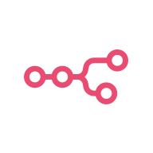

# n8n Component for Diploi

Start a demo, no card required https://diploi.com/component/n8n

Uses the official [n8nio/n8n](https://hub.docker.com/r/n8nio/n8n) Docker image as it is (n8n 2.45). The version is the `images[].image` tag in `diploi.yaml`.

Requires **PostgreSQL**, which is included as a Diploi add-on. The AI nodes and n8n Assistant run on the Diploi AI proxy, so they work without an API key of your own.

## Operation

### Getting started

1. In the Dashboard, click **Create Project +**
2. Under **Pick Components**, choose **n8n**
3. In **Pick Add-ons**, PostgreSQL is required and selected by default.
4. Choose **Create Repository** so Diploi generates a new GitHub repo for your project.
5. Click **Launch Stack**

How to add a custom domain and launch to production: https://diploi.com/blog/hosting_n8n

### Login

Log in with the email and password under **Admin login** in the deployment's **Setup** tab. The email is `admin@example.com` by default, and the password is generated for every project.

Change both in n8n's personal settings after the first login. The Setup tab's values are only read on the first start.

### First start

A `setup` container runs beside n8n in its pod. On every start it creates n8n's own database (**Database name** in the Setup tab, default `n8n`) on the PostgreSQL add-on if it is missing, and n8n waits for that. When n8n first starts on an empty database, the container also creates the owner account from **Admin login**, and switches on n8n's MCP server and its **Auto-expose new workflows** setting for the [Prompt tab](#prompt-tab).

On every start it then gives the prompt tab's agent its access and writes the **Diploi AI** credential, see [AI](#ai). The script lives in the component's helm files (`.diploi/helm/app-scripts.yaml`), so it is updated with the component rather than being frozen in the user project. The `setup` container is a plain Alpine that installs `psql`, `jq` and `curl` when it starts, which takes a few seconds.

If the setup fails, the `setup` container's log says why. Finish it in the browser: n8n asks for an owner account while there is none, and the next start does the rest.

### AI

The AI features use the Diploi AI proxy, and their use is billed to your Diploi account as AI usage. The **AI** switch in the Setup tab turns both of them on or off.

- **The Diploi AI credential.** Every start writes the Anthropic credential **Diploi AI**, with the proxy's address and the deployment's token. Choose it in the Anthropic nodes, such as the Anthropic Chat Model of an AI Agent, and pick a Claude model, such as `claude-sonnet-5-5` or `claude-haiku-5-5`. Keep its name: a start that finds no credential of that name creates a new one, and it overwrites changes to its key and address. Turning the switch off deletes it.
- **n8n Assistant**, n8n's own AI chat, runs on the model in **Assistant model**, default `anthropic/claude-sonnet-5-5`. It needs a sandbox to build workflows, which this component does not set up, so ask the agent in the prompt tab to build them instead. The model is set through environment variables, so n8n's AI settings show it as read-only.

To use your own Anthropic key, create an Anthropic credential of your own. For n8n Assistant, turn the switch off and set the model in n8n's AI settings.

### Prompt tab

The agent in the Diploi prompt tab can use n8n's [MCP server](https://docs.n8n.io/advanced-ai/accessing-n8n-mcp-server/), so you can ask it to build, change, test and run workflows. It acts as n8n's owner.

The agent reaches the MCP server with the **Access token** under **Prompt tab** in the Setup tab. The Diploi core adds the token to the agent's requests, so it never reaches the development environment. Every start writes the token into n8n's database as the owner's MCP API key `Diploi agent`.

- **The agent sees the workflows that are available in MCP.** New workflows are, and the ones it creates. Switch an older one on in its settings, or in **Settings > Instance-level MCP**.
- **To switch its access off**, turn off **Prompt tab** in the Setup tab. The key is deleted. n8n's MCP server stays on for your own MCP clients: switch it off in **Settings > Instance-level MCP**.
- **To rotate the token**, change the **Access token**.
- **Rotating the owner's MCP API key in n8n** deletes the agent's key too, until the next start writes it again.

### Storage

n8n keeps workflows, credentials and executions in its PostgreSQL database. Back up the add-on to back up n8n.

The component has no volumes, so what n8n writes to its own disk is lost when it restarts:

- Binary data of executions, such as files a workflow downloaded. Set `N8N_DEFAULT_BINARY_DATA_MODE` to `database` in the **Environment** tab to keep it in PostgreSQL.
- Community nodes installed in the editor. Set `N8N_REINSTALL_MISSING_PACKAGES` to `true` to have n8n install them again when it starts.

### Setup tab

The deployment's **Setup** tab holds the values a project chooses. Each is also an environment variable of the containers.

| Group       | Field           | Variable                 | Description                                                                                 |
| ----------- | --------------- | ------------------------ | ------------------------------------------------------------------------------------------- |
| Admin login | Email           | `INITIAL_ADMIN_EMAIL`    | Email address of the owner account created on the first start. Default `admin@example.com`. |
| Admin login | Password        | `INITIAL_ADMIN_PASSWORD` | Password of that account. Generated per project.                                            |
| Database    | Database name   | `DB_POSTGRESDB_DATABASE` | n8n's own database on the PostgreSQL add-on. Default `n8n`.                                 |
| Keys        | Encryption key  | `N8N_ENCRYPTION_KEY`     | Encrypts n8n's credentials. Generated per project. Never change it.                         |
| AI          | the switch      | `DIPLOI_AI_ENABLED`      | The Diploi AI credential and n8n Assistant, through the Diploi AI proxy. Default on.        |
| AI          | Assistant model | `DIPLOI_AI_MODEL`        | The model n8n Assistant runs on. Default `anthropic/claude-sonnet-5-5`.                     |
| Prompt tab  | the switch      | `DIPLOI_AGENT_ENABLED`   | Whether the prompt tab's agent may use n8n's MCP server. Default on.                        |
| Prompt tab  | Access token    | `N8N_AGENT_TOKEN`        | The agent's token for the MCP server. Generated per project.                                |

### Environment variables

| Variable                                   | Description                                                                                                                      |
| ------------------------------------------ | -------------------------------------------------------------------------------------------------------------------------------- |
| `N8N_EDITOR_BASE_URL`, `WEBHOOK_URL`       | The public address of n8n, from the component's host. Used in links, OAuth and webhook URLs.                                     |
| `N8N_SECURE_COOKIE`, `N8N_SAMESITE_COOKIE` | `true` and `none`: browsers send the login cookie over HTTPS only, also to n8n embedded in another site.                         |
| `N8N_VERSION_NOTIFICATIONS_ENABLED`        | `false`. Diploi decides the n8n version.                                                                                         |
| `N8N_MCP_SERVER_RATE_LIMIT`                | `0`. Every request of the prompt tab's agent comes from the Diploi core's address, which n8n's limit per address would throttle. |
| `DIPLOI_AI_URL`, `DIPLOI_AI_TOKEN`         | The Diploi AI proxy, and the deployment's token for it, which changes whenever the deployment starts.                            |
| `DB_TYPE`, `DB_POSTGRESDB_SCHEMA`, `TZ`    | `postgresdb`, `public` and `UTC`.                                                                                                |

PostgreSQL connection details (`DB_POSTGRESDB_HOST`, `DB_POSTGRESDB_PORT`, `DB_POSTGRESDB_USER`, `DB_POSTGRESDB_PASSWORD`) come from the PostgreSQL add-on.

Any other [n8n environment variable](https://docs.n8n.io/hosting/configuration/environment-variables/) can be added in the **Environment** tab.

### Development and production

Every stage runs the same upstream image, and n8n serves on port **5678**. There is nothing to build: this folder holds no code, and n8n is configured in its editor, in the Setup tab and through environment variables. To move to another n8n version, change the image tag in `diploi.yaml`.

The first start migrates n8n's database, which can take a few minutes on a small core. The deployment waits for `/healthz/readiness` before it sends traffic to a new version.

To build your own nodes, see n8n's [documentation](https://docs.n8n.io/integrations/creating-nodes/build/), and publish them as community nodes.

## Links

- [Adding n8n to a project](https://docs.diploi.com/building/components/n8n)
- [n8n documentation](https://docs.n8n.io/)
- [n8n MCP server](https://docs.n8n.io/advanced-ai/accessing-n8n-mcp-server/)
- [n8n environment variables](https://docs.n8n.io/hosting/configuration/environment-variables/)
